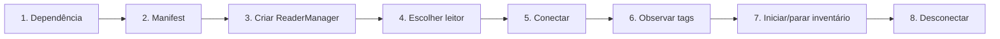

# Guia de integração: criando um app Android com a SmartX RFID

Este guia mostra, passo a passo, como usar a biblioteca para fazer um app que **escolhe um leitor, conecta, lê tags e encerra a conexão**. Todo o fluxo passa por uma única classe, o `ReaderManager`; o app nunca chama diretamente os SDKs dos fabricantes.

Para consultar cada classe e campo em detalhe, veja a [referência da API](REFERENCIA_API.md).

## Visão geral do fluxo



| Passo | O que você faz                             | API principal                            |
| ----- | ------------------------------------------ | ---------------------------------------- |
| 1     | Adiciona a biblioteca ao projeto           | Gradle                                   |
| 2     | Ajusta o manifesto e as permissões         | `AndroidManifest.xml`                    |
| 3     | Cria um `ReaderManager` para o app inteiro | `ReaderManager`, `ReaderRegistry`        |
| 4     | Lista e escolhe o leitor                   | `manager.readers`, `findById`            |
| 5     | Conecta (integrado ou Bluetooth)           | `manager.connect`, `ConnectionRequest`   |
| 6     | Recebe estado e tags                       | `manager.state`, `manager.tags`          |
| 7     | Inicia/para a leitura (botão ou gatilho)   | `startInventory`, `onKeyDown`, `onKeyUp` |
| 8     | Ajusta potência/filtros e desconecta       | `applyConfig`, `TagFilter`, `disconnect` |

## Requisitos

- Android com `minSdk 26` ou superior (veja o passo 1 se for usar o leitor **Zebra**).
- JDK 17 e Android Gradle Plugin 8.x.
- Kotlin e coroutines (a biblioteca já traz `kotlinx-coroutines-android`).
- Token do GitHub com permissão `read:packages` (o GitHub Packages exige autenticação até para baixar).
- Para leitores BLE, permissões Bluetooth declaradas e concedidas em runtime.

Os exemplos usam a versão `1.3.4`. Confira a última versão publicada na página do pacote antes de integrar.

---

## Passo 1. Adicionar a biblioteca ao projeto

### 1.1 Repositório Maven

No `settings.gradle.kts` do app (ou `settings.gradle`, em Groovy), inclua o repositório ao lado de `google()` e `mavenCentral()`:

```kotlin
dependencyResolutionManagement {
    repositories {
        google()
        mavenCentral()
        maven {
            url = uri("https://maven.pkg.github.com/ghpascon/smartx-rfid-android")
            credentials {
                username = providers.gradleProperty("gpr.user").orNull
                    ?: System.getenv("GITHUB_ACTOR")
                password = providers.gradleProperty("gpr.key").orNull
                    ?: System.getenv("GITHUB_TOKEN")
            }
        }
    }
}
```

Guarde as credenciais em `~/.gradle/gradle.properties` (arquivo da sua máquina, fora do projeto). **Nunca** coloque o token no controle de versão:

```properties
gpr.user=SEU_USUARIO_GITHUB
gpr.key=SEU_TOKEN_COM_READ_PACKAGES
```

Em CI, use secrets protegidos expostos como `GITHUB_ACTOR` e `GITHUB_TOKEN`.

### 1.2 Dependência

No `build.gradle.kts` do módulo `app`:

```kotlin
dependencies {
    implementation("com.smartx.rfid:smartx-rfid:1.3.4")

    // Usados nos exemplos deste guia
    implementation("androidx.lifecycle:lifecycle-runtime-ktx:2.8.4")
    implementation("androidx.lifecycle:lifecycle-viewmodel-ktx:2.8.4")
    implementation("androidx.activity:activity-ktx:1.9.1")
}
```

Os SDKs dos fabricantes vêm como dependências transitivas; **não** copie AARs para o app.

No `gradle.properties` do app, habilite o Jetifier (necessário para as bibliotecas legadas do SDK TSL):

```properties
android.enableJetifier=true
```

### 1.3 Ajustes de merge do manifesto (SDK Zebra)

O SDK da Zebra, incluído na biblioteca, declara `minSdk 29` e um `android:label` próprio. Se o build do app falhar em `processDebugMainManifest`, aplique:

```xml
<!-- AndroidManifest.xml do app -->
<manifest xmlns:android="http://schemas.android.com/apk/res/android"
    xmlns:tools="http://schemas.android.com/tools">

    <!-- Só necessário se o app tiver minSdk < 29. O leitor ZEBRA só funciona no Android 10+. -->
    <uses-sdk tools:overrideLibrary="com.zebra.rfid.api3" />

    <application
        android:label="@string/app_name"
        tools:replace="android:label"
        ... >
```

Alternativa à linha `uses-sdk`: usar `minSdk 29` no app.

---

## Passo 2. Declarar permissões

A biblioteca já declara no próprio manifesto (e o Gradle as inclui no app): `INTERNET`, `BLUETOOTH`, `BLUETOOTH_ADMIN`, `BLUETOOTH_CONNECT`, `BLUETOOTH_SCAN` e `ACCESS_FINE_LOCATION` (esta só até a API 30).

| Tipo de leitor                                  | Permissão em runtime?                                                                             |
| ----------------------------------------------- | ------------------------------------------------------------------------------------------------- |
| Integrado (C72, P80, XR2) e `SIMULATOR`         | Não                                                                                               |
| Bluetooth (IH25, ZEBRA, TSL1128, X714, CF-H301) | Sim: `BLUETOOTH_SCAN` e `BLUETOOTH_CONNECT` no Android 12+; localização no Android 11 ou anterior |

A solicitação em runtime está no [passo 5.3](#53-leitor-bluetooth).

---

## Passo 3. Criar o ReaderManager

O `ReaderManager` guarda a conexão e as tags lidas. Crie **uma instância por processo**, na classe `Application`, para que telas e serviços compartilhem o mesmo leitor:

```kotlin
class RfidApplication : Application() {

    lateinit var readerManager: ReaderManager
        private set

    override fun onCreate() {
        super.onCreate()
        readerManager = ReaderManager(
            context = this,
            // Somente os leitores que o seu app suporta:
            readers = ReaderRegistry.create(listOf("SIMULATOR", "C72", "P80", "ZEBRA"))
        )
    }
}
```

Registre a classe no manifesto:

```xml
<application
    android:name=".RfidApplication"
    ... >
```

Sem argumento de leitores, `ReaderManager(context)` cria todos os leitores embutidos. Os IDs válidos estão na [referência da API](REFERENCIA_API.md#leitores-embutidos); para listá-los em código, use `SmartxRfid.supportedReaderIds()`.

Em qualquer tela, acesse a instância:

```kotlin
val manager = (application as RfidApplication).readerManager
```

---

## Passo 4. Escolher o leitor

`manager.readers` traz os leitores disponíveis. Cada um informa o que precisa:

```kotlin
manager.readers.forEach { reader ->
    reader.readerId                 // "C72", "ZEBRA"... (estável)
    reader.displayName              // "Chainway C72" (para exibir ao usuário)
    reader.isBle                    // true: precisa escolher um dispositivo Bluetooth
    reader.connectionOptions        // INTEGRATED, BLUETOOTH, SERIAL
    reader.capabilities             // gatilho por tecla, reconexão automática...
}

// Ou direto pelo ID:
val reader = manager.findById("P80") ?: return
```

Se o app for dedicado a um só equipamento, fixe o ID. Se for genérico, mostre `displayName` em uma lista (`Spinner`, `RecyclerView`, etc.) e guarde o ID escolhido para reconectar depois (salvando-o em `SharedPreferences` ou `DataStore`).

---

## Passo 5. Conectar

`manager.connect(...)` é uma função **suspensa**: chame-a em uma coroutine (`lifecycleScope` ou `viewModelScope`). Por padrão tenta conectar até 3 vezes, com 1 segundo entre as tentativas. Ao conectar, ela lê e reaplica a configuração do leitor, publica o leitor em `manager.activeReader` e começa a coletar as tags.

Retorna `true` se conectou. Em caso de falha, veja `manager.state.value.lastError` e o log de conexão em `manager.connectionLog`.

### 5.1 Leitor integrado (C72, P80, XR2) e simulador

```kotlin
lifecycleScope.launch {
    val reader = manager.findById("P80") ?: return@launch
    val ok = manager.connect(reader)
    if (!ok) {
        showError(manager.state.value.lastError)
        // manager.connectionLog.value: linhas de diagnóstico da tentativa
    }
}
```

### 5.2 Mostrar o log da conexão (opcional)

```kotlin
lifecycleScope.launch {
    manager.connectionLog.collect { linhas ->
        logTextView.text = linhas.joinToString("\n")
    }
}
```

### 5.3 Leitor Bluetooth

Fluxo: pedir permissões, procurar dispositivos, o usuário escolher um e o app conectar com o endereço MAC.

**a) Permissões em runtime**

```kotlin
class ReaderActivity : AppCompatActivity() {

    private val bluetoothPermissions =
        registerForActivityResult(ActivityResultContracts.RequestMultiplePermissions()) { result ->
            if (result.values.all { it }) startScan() else showError("Permissão Bluetooth negada")
        }

    private fun ensureBlePermissionsAndScan() {
        val missing = BlePermissions.missing(this)
        if (missing.isEmpty()) startScan()
        else bluetoothPermissions.launch(missing.toTypedArray())
    }
}
```

**b) Procurar dispositivos**

O scan dura 15 segundos por padrão, pode incluir dispositivos já pareados e pode repetir o mesmo endereço. Deduplique por `address`:

```kotlin
private val found = linkedMapOf<String, BleDevice>()

private fun startScan() {
    found.clear()
    lifecycleScope.launch {
        BleScanner(this@ReaderActivity).scan().collect { device ->
            found[device.address] = device          // evita duplicatas
            adapter.submit(found.values.toList())   // atualiza a lista na tela
        }
    }
}
```

`BleDevice` tem `name`, `address` e `isPaired`. Também é possível filtrar pelo nome no app, para mostrar apenas os dispositivos do modelo escolhido.

**c) Conectar no dispositivo escolhido**

```kotlin
private fun connectTo(reader: IRfidReader, device: BleDevice) {
    lifecycleScope.launch {
        val request = ConnectionRequest(
            option = ConnectionOption.BLUETOOTH,
            address = device.address
        )
        val ok = manager.connect(reader, request)
        if (!ok) showError(manager.state.value.lastError)
    }
}
```

O leitor **Zebra** também aceita `ConnectionOption.SERIAL`. Quando `reader.connectionOptions` tiver mais de uma opção, pergunte ao usuário qual usar.

### 5.4 Reconexão automática

Se `reader.capabilities.supportsAutoReconnect` for `true`, o app pode guardar o ID (e, em BLE, o MAC) do último leitor e conectar de novo ao abrir. Quando for `false` (como no Zebra), peça ao usuário para escolher novamente.

---

## Passo 6. Acompanhar estado e tags

Colete os fluxos respeitando o ciclo de vida da tela, com `repeatOnLifecycle`:

```kotlin
lifecycleScope.launch {
    repeatOnLifecycle(Lifecycle.State.STARTED) {

        // 1) Estado geral (conexão, inventário, erro)
        launch {
            manager.state.collect { s ->
                s.connectionState   // DISCONNECTED, CONNECTING, CONNECTED, ERROR
                s.isConnected
                s.isConnecting
                s.isInventorying    // true enquanto está lendo
                s.activeReader      // leitor conectado (ou null)
                s.config            // configuração atual do leitor
                s.lastError         // mensagem do último erro
            }
        }

        // 2) Lista consolidada por EPC (ideal para a tela)
        launch {
            manager.tags.tags.collect { lista: List<RfidTag> ->
                adapter.submit(lista)
                totalTextView.text = "${lista.size} tags"
            }
        }

        // 3) Cada leitura, imediatamente (ideal para bipe/vibração/contador)
        launch {
            manager.tags.events.collect { tag: RfidTag ->
                beep()
            }
        }
    }
}
```

**Diferença entre os dois fluxos de tags**

| Fluxo                 | Entrega                                                   | Use para                         |
| --------------------- | --------------------------------------------------------- | -------------------------------- |
| `manager.tags.tags`   | Lista sem repetições (por EPC), atualizada a cada ~200 ms | Listas e contadores na interface |
| `manager.tags.events` | Toda leitura aceita, sem espera                           | Bipe, vibração, regras imediatas |

Cada `RfidTag` traz `epc`, `tid`, `user`, `rssi`, `antenna`, `readCount` (quantas vezes foi lida) e `timestamp`.

Também há `manager.tags.count` (EPCs únicos), `manager.tags.snapshot()` (cópia imediata da lista) e `manager.clearTags()` (limpa a lista, por exemplo no botão "Nova contagem").

---

## Passo 7. Iniciar e parar a leitura

### 7.1 Por botão na tela

```kotlin
startButton.setOnClickListener {
    if (!manager.startInventory()) showError("Conecte um leitor antes de iniciar")
}
stopButton.setOnClickListener { manager.stopInventory() }

// Ou um único botão que alterna:
toggleButton.setOnClickListener { manager.toggleInventory() }
```

`startInventory()` retorna `false` se não houver leitor conectado ou se ele não iniciar. O estado atual fica em `manager.state.value.isInventorying`.

### 7.2 Pelo gatilho físico

Há dois comportamentos, dependendo do leitor (`reader.capabilities.usesKeyEventTrigger`):

| Leitor                                        | Como o gatilho funciona                                             | O que o app faz                          |
| --------------------------------------------- | ------------------------------------------------------------------- | ---------------------------------------- |
| C72, P80, XR2 (`true`)                        | O botão chega ao app como tecla do Android (`KeyEvent`)             | Encaminhar as teclas ao manager (abaixo) |
| IH25, ZEBRA, TSL1128, X714, CF-H301 (`false`) | O próprio leitor avisa; o manager atualiza `isInventorying` sozinho | Nada: apenas observe `manager.state`     |

Para os leitores de gatilho por tecla, encaminhe os eventos na Activity. Ignore as repetições da tecla segurada:

```kotlin
override fun dispatchKeyEvent(event: KeyEvent): Boolean {
    val handled = when (event.action) {
        KeyEvent.ACTION_DOWN ->
            event.repeatCount == 0 && manager.onKeyDown(event.keyCode)
        KeyEvent.ACTION_UP ->
            manager.onKeyUp(event.keyCode)
        else -> false
    }
    return handled || super.dispatchKeyEvent(event)
}
```

Comportamento "segurou, lê; soltou, para": `onKeyDown` inicia a leitura e `onKeyUp` para.

- `onKeyDown(keyCode)` e `onKeyUp(keyCode)` só reagem às teclas listadas em `reader.capabilities.triggerKeyCodes` (no P80: `131, 139, 280, 291, 293, 294, 295, 311`) e retornam `true` quando tratam a tecla. As demais teclas passam direto.
- A tecla recebida é registrada no Logcat com a tag `ReaderManager`, o que ajuda a descobrir o código do botão do seu aparelho.
- Se a lista `triggerKeyCodes` do leitor estiver vazia, qualquer tecla é tratada como gatilho, e você pode chamar `manager.onTriggerPressed()` / `onTriggerReleased()` diretamente.

> O P80 tem um app de teste em `reader_tests/p80` que mostra as teclas recebidas, o início e a parada da leitura e as tags lidas. Instale com `./gradlew :reader_tests:p80:installDebug`.

---

## Passo 8. Configuração, filtros e desconexão

### 8.1 Configuração do leitor

```kotlin
lifecycleScope.launch {
    val atual: ReaderConfig? = manager.readConfig()

    val aplicou = manager.applyConfig(
        ReaderConfig(
            txPower = 25,                                   // potência em dBm
            session = 1,                                    // sessão Gen2: 0 a 3
            rssiFilter = -70,                               // ignora tags mais fracas
            inventoryMode = ReaderConfig.InventoryMode.EPC_TID, // EPC_ONLY, EPC_TID ou EPC_TID_USER
        )
    )
    if (!aplicou) showError("O leitor não aceitou a configuração")
}
```

Nem todo hardware suporta todos os campos; confira o retorno de `applyConfig()`. O parâmetro `region` só vale para o C72 (`-1` usa o padrão do hardware). Quando o leitor está em `EPC_TID`, o TID chega no campo `tid` da tag.

### 8.2 Filtro de tags no app

```kotlin
manager.tags.filter = TagFilter(
    prefixes = listOf("E200", "3008"),  // só EPCs que começam assim (sem diferenciar maiúsculas)
    minRssi = -80                       // descarta RSSI numérico menor que -80
)
```

O filtro vale para as próximas tags recebidas. Lista `prefixes` vazia aceita qualquer EPC.

### 8.3 Desconectar

```kotlin
lifecycleScope.launch {
    manager.disconnect()   // para o inventário, desconecta e limpa as tags
}
```

Como o `ReaderManager` pertence à `Application`, **não** chame `release()` ao fechar uma tela. Use `release()` só quando o gerenciador não for mais reutilizado: ele desconecta e cancela o escopo interno.

Recomendação de ciclo de vida: pare a leitura quando a tela sair de primeiro plano e desconecte quando o usuário encerrar o fluxo:

```kotlin
override fun onPause() {
    manager.stopInventory()
    super.onPause()
}
```

---

## Exemplo completo

Um app mínimo com um `Spinner` de leitores, botões Conectar/Ler/Desconectar, contador e lista de EPCs. Use `SIMULATOR` para testar sem hardware.

**`activity_reader.xml`**

```xml
<LinearLayout xmlns:android="http://schemas.android.com/apk/res/android"
    android:layout_width="match_parent"
    android:layout_height="match_parent"
    android:orientation="vertical"
    android:padding="16dp">

    <Spinner android:id="@+id/readerSpinner"
        android:layout_width="match_parent" android:layout_height="wrap_content" />

    <Button android:id="@+id/connectButton"
        android:layout_width="match_parent" android:layout_height="wrap_content"
        android:text="Conectar" />

    <Button android:id="@+id/readButton"
        android:layout_width="match_parent" android:layout_height="wrap_content"
        android:text="Iniciar leitura" android:enabled="false"
        android:focusable="false" />

    <Button android:id="@+id/clearButton"
        android:layout_width="match_parent" android:layout_height="wrap_content"
        android:text="Limpar" android:focusable="false" />

    <TextView android:id="@+id/statusText"
        android:layout_width="match_parent" android:layout_height="wrap_content"
        android:paddingTop="8dp" />

    <ListView android:id="@+id/tagList"
        android:layout_width="match_parent" android:layout_height="0dp"
        android:layout_weight="1" />
</LinearLayout>
```

**`ReaderActivity.kt`**

```kotlin
class ReaderActivity : AppCompatActivity() {

    private val manager by lazy { (application as RfidApplication).readerManager }
    private lateinit var tagAdapter: ArrayAdapter<String>

    private lateinit var readerSpinner: Spinner
    private lateinit var connectButton: Button
    private lateinit var readButton: Button
    private lateinit var statusText: TextView

    override fun onCreate(savedInstanceState: Bundle?) {
        super.onCreate(savedInstanceState)
        setContentView(R.layout.activity_reader)

        readerSpinner = findViewById(R.id.readerSpinner)
        connectButton = findViewById(R.id.connectButton)
        readButton = findViewById(R.id.readButton)
        statusText = findViewById(R.id.statusText)

        // 4. Escolher o leitor
        readerSpinner.adapter = ArrayAdapter(
            this, android.R.layout.simple_spinner_dropdown_item,
            manager.readers.map { it.displayName }
        )

        tagAdapter = ArrayAdapter(this, android.R.layout.simple_list_item_1)
        findViewById<ListView>(R.id.tagList).adapter = tagAdapter

        // 5. Conectar / desconectar
        connectButton.setOnClickListener {
            lifecycleScope.launch {
                if (manager.state.value.isConnected) {
                    manager.disconnect()
                } else {
                    val reader = manager.readers[readerSpinner.selectedItemPosition]
                    // Para leitores BLE, veja o passo 5.3 (permissões, scan e MAC)
                    manager.connect(reader)
                }
            }
        }

        // 7. Iniciar/parar leitura
        readButton.setOnClickListener { manager.toggleInventory() }
        findViewById<Button>(R.id.clearButton).setOnClickListener { manager.clearTags() }

        // 6. Observar estado e tags
        lifecycleScope.launch {
            repeatOnLifecycle(Lifecycle.State.STARTED) {
                launch { manager.state.collect(::renderState) }
                launch { manager.tags.tags.collect(::renderTags) }
            }
        }
    }

    private fun renderState(s: ReaderManagerState) {
        connectButton.text = if (s.isConnected) "Desconectar" else "Conectar"
        connectButton.isEnabled = !s.isConnecting
        readerSpinner.isEnabled = !s.isConnected
        readButton.isEnabled = s.isConnected
        readButton.text = if (s.isInventorying) "Parar leitura" else "Iniciar leitura"
        statusText.text = when {
            s.isConnecting -> "Conectando..."
            s.isConnected -> "Conectado em ${s.activeReader?.displayName}" +
                if (s.isInventorying) " (lendo)" else ""
            s.lastError != null -> s.lastError.orEmpty()
            else -> "Desconectado"
        }
    }

    private fun renderTags(tags: List<RfidTag>) {
        tagAdapter.clear()
        tagAdapter.addAll(tags.map { "${it.epc}  x${it.readCount}  RSSI ${it.rssi}" })
        tagAdapter.notifyDataSetChanged()
    }

    // 7.2 Gatilho físico (C72, P80, XR2)
    override fun dispatchKeyEvent(event: KeyEvent): Boolean {
        val handled = when (event.action) {
            KeyEvent.ACTION_DOWN -> event.repeatCount == 0 && manager.onKeyDown(event.keyCode)
            KeyEvent.ACTION_UP -> manager.onKeyUp(event.keyCode)
            else -> false
        }
        return handled || super.dispatchKeyEvent(event)
    }

    override fun onPause() {
        manager.stopInventory()
        super.onPause()
    }
}
```

Imports usados: `com.smartx.rfid.manager.ReaderManagerState`, `com.smartx.rfid.core.RfidTag`, `androidx.lifecycle.Lifecycle`, `androidx.lifecycle.lifecycleScope`, `androidx.lifecycle.repeatOnLifecycle` e `kotlinx.coroutines.launch`. O botão Iniciar leitura e o Limpar têm `focusable="false"` para a tecla do gatilho não acionar o botão focado.

---

## Testar sem hardware

Inclua `"SIMULATOR"` na lista de leitores, conecte e inicie a leitura. O simulador emite uma tag por segundo (EPC começando por `00`, TID por `e28000`, com sufixo sequencial a partir de 1). Serve para validar interface e fluxo, não alcance, potência ou comportamento RF de um leitor real.

## Checklist de integração

- [ ] Repositório do GitHub Packages e credenciais configurados (passo 1).
- [ ] `RfidApplication` registrada no manifesto, com um único `ReaderManager` (passo 3).
- [ ] `connect()` chamado dentro de coroutine e `false` tratado com `lastError` (passo 5).
- [ ] Em leitores BLE: permissões em runtime, scan sem repetições e MAC enviado no `ConnectionRequest` (passo 5.3).
- [ ] Coleta de `state` e `tags` com `repeatOnLifecycle` (passo 6).
- [ ] Em C72, P80 e XR2: `dispatchKeyEvent` encaminhando `onKeyDown`/`onKeyUp` (passo 7.2).
- [ ] `stopInventory()` ao sair de primeiro plano e `disconnect()` ao encerrar (passo 8.3).

## Problemas comuns

| Sintoma                                              | O que verificar                                                                                                        |
| ---------------------------------------------------- | ---------------------------------------------------------------------------------------------------------------------- |
| HTTP 401 ao baixar a dependência                     | URL do repositório, usuário, token com `read:packages` e acesso ao pacote. Nunca versione o token.                     |
| `minSdkVersion 26 cannot be smaller than version 29` | SDK Zebra: use `minSdk 29` ou `tools:overrideLibrary="com.zebra.rfid.api3"` (passo 1.3).                               |
| `Attribute application@label ... is also present`    | Adicione `tools:replace="android:label"` na tag `<application>` (passo 1.3).                                           |
| BLE não encontra dispositivos                        | Bluetooth ligado, permissões de manifesto e de runtime concedidas, e o scan coletado dentro de uma coroutine.          |
| `connect()` retorna `false`                          | Veja `manager.state.value.lastError` e `manager.connectionLog`; confirme que o leitor está ligado e próximo.           |
| Tags não aparecem                                    | Leitor conectado, `startInventory()` retornou `true`, filtro `TagFilter` não está descartando tudo, potência adequada. |
| Gatilho físico não inicia a leitura                  | Em C72/P80/XR2, confirme o `dispatchKeyEvent`; veja o `keyCode` recebido no Logcat (tag `ReaderManager`).              |
| Configuração não aplicada                            | O hardware pode não suportar todos os campos; verifique o retorno de `applyConfig()`.                                  |
| Aparelho sem permissão de Bluetooth no Android 12+   | `BLUETOOTH_SCAN` e `BLUETOOTH_CONNECT` precisam ser concedidas em runtime (`BlePermissions.missing(context)`).         |
